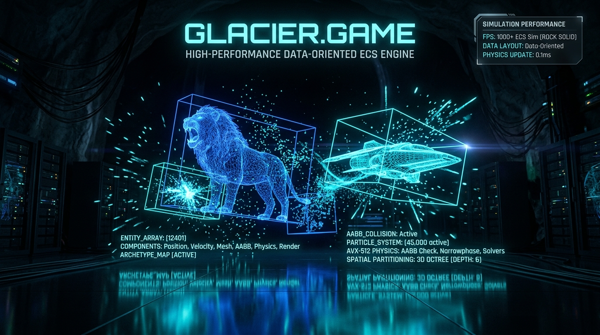
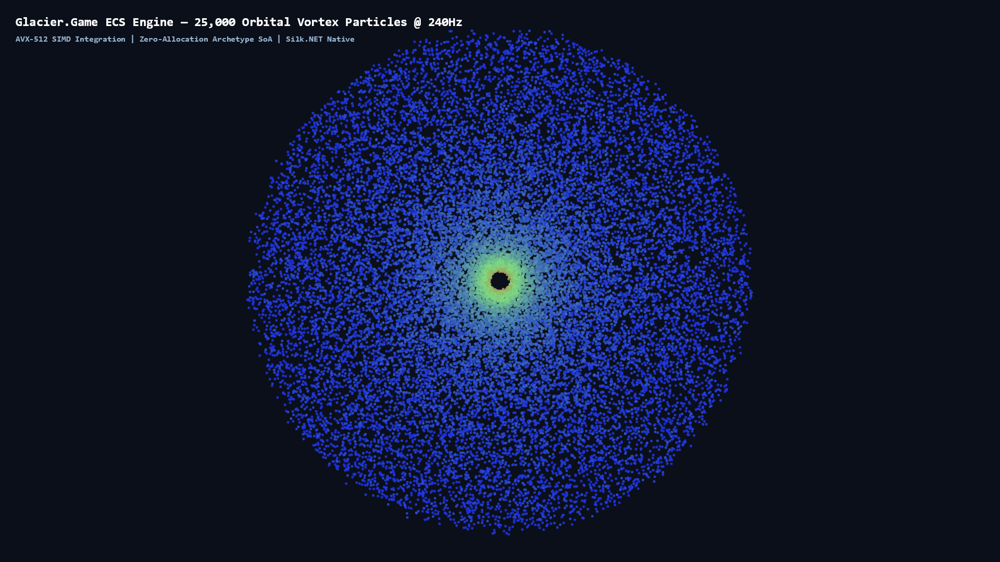
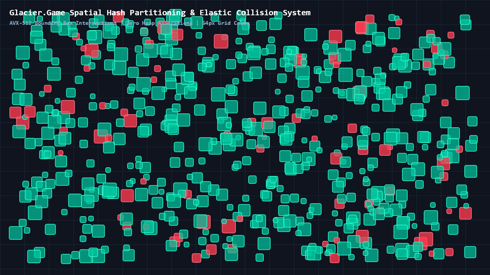

# 🎮 Glacier.Game

[](LICENSE)
[](https://dotnet.microsoft.com/)
[](https://learn.microsoft.com/dotnet/core/deploying/native-aot/)
[](https://www.nuget.org/packages/Glacier.Game/)
[](https://github.com/ian-cowley)
[](https://glaciersoftware.dev/)
[](https://buymeacoffee.com/glaciersoftware)

> **High-Performance Data-Oriented 2D ECS Game Engine for C# .NET 10 Native AOT**

`Glacier.Game` is a data-oriented game engine engineered in 100% pure C# for .NET 10. It combines a 64-byte cache-aligned Entity Component System (ECS) with AVX-512 / AVX2 / AdvSimd collision and physics kernels, native `Glacier.Windowing` Direct3D 12 / Vulkan / Software swapchain presentation, `Glacier.Graphics` rasterization, and low-latency WASAPI audio streaming.

---

## 1. Why Glacier.Game? Replacing Python Pygame

1. **Cache-Aligned Entity Component System (ECS)**: Components are stored in 64-byte-aligned unmanaged Struct-of-Arrays (`ArchetypeTable`) columns, streaming into SIMD lanes without GC heap pressure.
2. **Multi-Archetype Zero-Allocation Queries**: `foreach (var chunk in world.Query<Position2D, Velocity2D>())` enumerates every matching archetype table via `ref struct` spans with zero allocations.
3. **SIMD Collision & Physics Kernels**: Evaluates 16 Axis-Aligned Bounding Box (AABB) intersections concurrently via `Vector512<float>` (with AVX2 and ARM64 AdvSimd paths), paired with `SpatialGrid2D` broadphase partitioning.
4. **Pure C# Native HAL & Audio**: Zero Silk.NET / GLFW / SDL2 native wrapper DLLs; windowing, swapchains, raw input, and WASAPI audio run directly through `Glacier.Windowing`.

---

## 🖼️ Visual Gallery: Real Rendered Physics & ECS Simulation

| 25,000-Particle Gravitational Vortex (240Hz) | Spatial Hash Partitioning & Elastic Collisions |
| :---: | :---: |
|  |  |
| *Orbital gravitational vortex simulated via AVX-512 physics with velocity-gradient shading* | *Broadphase spatial hash grid with narrowphase world-space AABB intersection checks* |

---

## 2. Quickstart API

```csharp
using Glacier.Game.Core;
using Glacier.Game.Physics;
using Glacier.Game.Rendering;

using var engine = new GameEngine(new WindowConfig("Glacier Game", 1920, 1080));

// Register ECS Physics System
engine.World.AddSystem(new SimdPhysicsSystem(0f, 1920f, 0f, 1080f));

// Spawn 100,000 entities into contiguous 64-byte-aligned SoA memory arrays
for (int i = 0; i < 100_000; i++)
{
    engine.World.CreateEntity(
        new Position2D(Random.Shared.NextSingle() * 1920f, Random.Shared.NextSingle() * 1080f),
        new Velocity2D(1.5f, -0.8f),
        new AABB2D(-2f, -2f, 2f, 2f),
        Color32.Cyan
    );
}

// Run fixed-timestep simulation and swapchain presentation loop
engine.Run();
```

---

## 3. Ecosystem Cross-References

- **[Glacier Ecosystem Website](https://glaciersoftware.dev/)**: Unified .NET 10 high-performance architecture overview.
- **[Glacier.Windowing](https://github.com/ian-cowley/Glacier.Windowing)**: Native OS windowing, D3D12/Vulkan/Software swapchains, and WASAPI audio.
- **[Glacier.Graphics](https://github.com/ian-cowley/Glacier.Graphics)**: Pure C# 2D vector, text, and raster engine.
- **[Glacier.Polaris](https://github.com/ian-cowley/Glacier.Polaris)**: Columnar DataFrame telemetry export/import via `PolarisExtensions`.
- **[Glacier.Tensor](https://github.com/ian-cowley/Glacier.Tensor)**: Zero-copy RL observation & action tensor extraction via `TensorExtensions`.

---

## 🆕 What's New in v1.1.0

- **Multi-Archetype Zero-Allocation ECS Queries** — `Query<T...>` now enumerates all matching `ArchetypeTable` chunks (`ArchetypeChunk<T...>`) via a stack-only `ref struct` enumerator (`TotalCount`), ensuring `SimdPhysicsSystem`, `CollisionSystem`, `AudioSystem`, and `GameEngine.Render` process every matching entity across heterogeneous archetypes.
- **Exact Narrowphase World-Space AABB Intersection in `CollisionSystem`** — `CollisionSystem` now performs true world-space AABB overlap verification (`pos + box`) on broadphase `SpatialGrid2D` candidates with hash-bucket deduplication and dynamic entity-ID capacity growth.
- **Universal `ISwapchain` Backbuffer Copy** — `GlacierGraphicsGameRenderer.Present()` copies rendered RGBA frames to all CPU-mapped `ISwapchain` backends (including `D3D12Swapchain` and `SoftwareSwapchain`).
- **Upgraded to `Glacier.Windowing 1.1.0`, `Glacier.Graphics 1.1.0`, `Glacier.Polaris 1.1.0`, `Glacier.Tensor 1.1.0`, and `Glacier.Gpu 1.1.0`** with `<IsAotCompatible>true</IsAotCompatible>`, `<TreatWarningsAsErrors>true</TreatWarningsAsErrors>`, and zero transitive NuGet vulnerabilities.

---

## Credits

Developed by Ian Cowley and Antigravity (Google DeepMind).

---

## License

Licensed under the [MIT License](LICENSE). Copyright (c) 2026 Ian Cowley.

---

## ❄️ Glacier Ecosystem & Support

Part of the **[Glacier Ecosystem](https://glaciersoftware.dev/)** — high-performance, zero-allocation developer tooling and data engines natively built for modern C# and .NET 10.

* 🌐 **Website & Documentation**: [glaciersoftware.dev](https://glaciersoftware.dev/)
* ☕ **Buy Me a Coffee**: [buymeacoffee.com/glaciersoftware](https://buymeacoffee.com/glaciersoftware)
* ❤️ **GitHub Sponsors**: [github.com/sponsors/ian-cowley](https://github.com/sponsors/ian-cowley)
* 🐙 **All Repositories**: [github.com/ian-cowley](https://github.com/ian-cowley)
